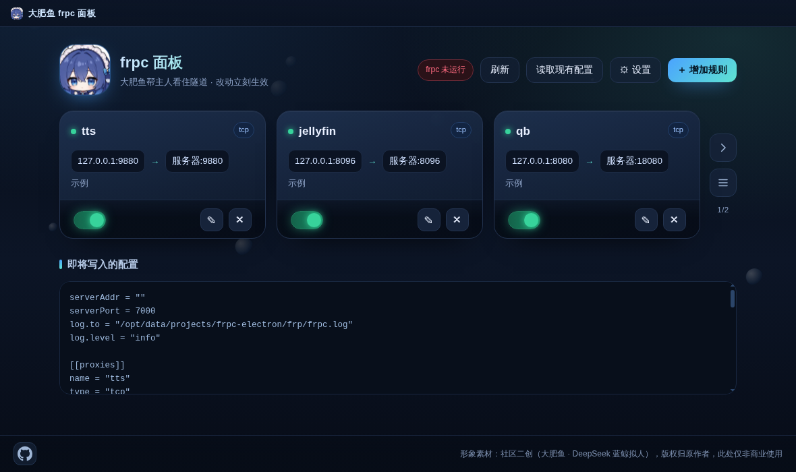
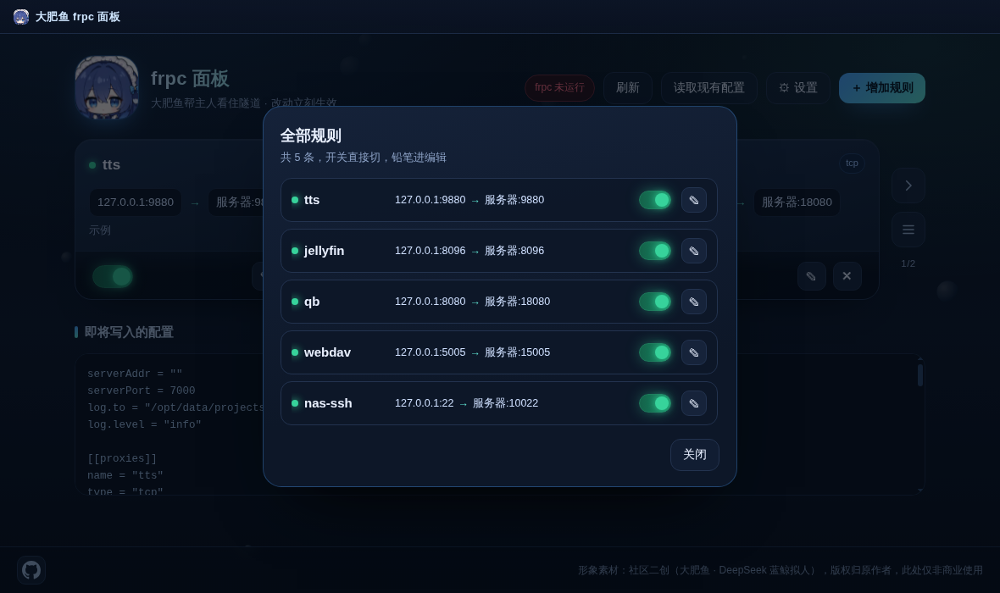

# 大肥鱼 frpc 面板





---

## 能干什么

- **卡片管隧道**：每条规则一张卡，显示名称、类型、`本地 → 远程` 端口、备注，右下角是开关和编辑 / 删除。
- **改完立刻生效**：开关、增删改规则、改 token，都会马上写回配置文件并重启 frpc，不用手动重启。
- **启动自动拉 frpc**：面板一开就把 `frp/frpc.exe` 带起来；已经在跑就不重复启动，配置没写也不会乱启。
- **一屏 3 张，翻页看**：规则按每 3 条一组分页，右侧箭头带淡出滑入动画，页码显示 `1/2`。
- **展开看全部**：列表弹窗里一次列出所有规则，可以直接切开关、点铅笔进编辑。
- **自动备份**：每次写配置前把老文件存成 `frpc.toml.bak_时间戳`。
- **托盘常驻**：关窗口只是收进托盘，隧道不断；托盘里能显示面板、打开 frp 目录、退出。

## 跑起来

```bash
git clone https://github.com/fatfish-Chan/frpc-panel-fish.git
cd frpc-panel-fish
npm install
npm start          # 只留托盘启动：npm run start:min
```

出 exe 看下面的「打包成 exe」，仓库不发 Releases，自己构建一份就行。

国内装 Electron 慢就挂镜像：

```bash
set ELECTRON_MIRROR=https://npmmirror.com/mirrors/electron/
npm install
```

## 第一次使用要注意

- `frpc.exe` 和配置文件要放在**同一个 `frp` 文件夹**里（源码跑就放项目根的 `frp/`），路径不一样也能在「⚙ 设置」里手填。
- 配置文件没有的话，面板会根据现有规则自己生成一份。
- 服务端地址、端口、token 在「⚙ 设置」里填，保存后自动写进配置。

## 界面速览

| 位置 | 有什么 |
|---|---|
| 顶部自绘标题栏 | 拖动能移窗口，右边是最小化、收进托盘 |
| 标题栏下方状态 | `frpc 运行中` / `未运行`，旁边是刷新、读取现有配置、设置 |
| 卡片区 | 每屏 3 张，右侧竖排是「下一组」和「展开」 |
| 规则卡片 | 名称、类型标签、本地端口 → 远程端口、备注、开关、编辑、删除 |
| 即将写入的配置 | 实时预览最终写盘的配置内容 |
| 底部页脚 | GitHub 图标（点开仓库）+ 素材说明，固定在窗口最底 |

窗口大小固定不可缩放，右上角关闭是收进托盘，不是退出。

## 配置文件支持

**TOML（frp v0.52+）**

```toml
serverAddr = "1.2.3.4"
serverPort = 7000
auth.token = "你的 token"

[[proxies]]
name = "tts"
type = "tcp"
localIP = "127.0.0.1"
localPort = 9880
remotePort = 9880
comment = "语音服务"
```

**INI（老版本）**

```ini
[common]
server_addr = 1.2.3.4
server_port = 7000
token = 你的 token

[tts]
type = tcp
local_ip = 127.0.0.1
local_port = 9880
remote_port = 9880
```

格式在「⚙ 设置」里切，面板会按选的格式读写，两种都能自动识别。

## 目录结构

```
main.js        窗口 / 托盘 / 单实例 / 自绘标题栏 / 启动拉起 frpc
preload.js     给页面暴露窗口控制（最小化、收进托盘）
server.js      内置 HTTP 后端：规则读写、配置生成、重启 frpc
renderer/      前端页面和大肥鱼图标
docs/          README 用的截图
scripts/       打包后瘦身钩子
frp/           放你的 frpc.exe 和配置（打包时一起带走）
data/          规则与设置，自动生成
```

## 端口与数据

- 后端固定 `127.0.0.1:8899`，只监听本机，外网访问不到。
- 端口被占时不再另起，直接连上已经在跑的那个实例。
- 规则和设置存在 `data/`，配置写到你指定的 `frpc.toml` / `frpc.ini`。

## 打包成 exe

```bash
npm run build       # 出单文件 exe，产物在 dist/大肥鱼frpc面板.exe
npm run build:dir   # 只要解包目录，调试快
```

打出来的 exe 是绿色单文件，放到任意文件夹，旁边建个 `frp\` 塞进 `frpc.exe` 和配置就能双击跑。

在 Linux 上交叉打包 Windows exe 需要关掉签名改写（`build.win.signAndEditExecutable: false`，仓库里已经配好），否则会因为没有 wine 报错。

## 常见问题

**双击没反应 / 起了就退？**
先看 `frp/frpc.exe` 在不在。面板会自动找同目录的 `frp`，找不到就在设置里手填绝对路径。

**卡片有了，隧道不通？**
面板只管客户端配置，服务端 `frps` 得在服务器上跑着，token 和端口要对得上。frpc 起不来时面板右下会弹提示，日志看设置的日志路径。

**为什么会弹 Windows 安全提示？**
自己打包的单文件 exe 没有签名证书，SmartScreen 对新程序会拦一下，点「更多信息 → 仍要运行」即可。

**能管多少条规则？**
没有硬上限，多到 4 条以上就开始分页，每页 3 条。

## 关于形象素材

界面里的大肥鱼形象来自社区二创（「大肥鱼」= DeepSeek 蓝鲸拟人的二创形象），版权归原作者所有。本项目只在个人使用范围内引用，不做商业用途；原作者如果希望撤下，开个 issue 会立刻替换。

## License

代码部分 MIT。

## 更新日志

| 版本 | 变化 |
|---|---|
| 1.6.0 | 窗口高度收到 600~700，一屏放下不滚动 |
| 1.5.0 | 翻组 / 展开按钮挪到卡片右侧；规则弹窗加开关和编辑；配置预览降高；页脚固定底部 |
| 1.4.0 | 规则改每 3 张一组 +「下一组」切换动画；加「展开」列表弹窗 |
| 1.3.0 | 启动自动拉起 frpc；删掉「全览」；页脚改 GitHub 图标跳转 |
| 1.2.0 | 无边框自绘标题栏、固定窗口、托盘常驻 |
| 1.0.0 | 第一版：卡片式规则管理、自动写配置、重载 frpc |
